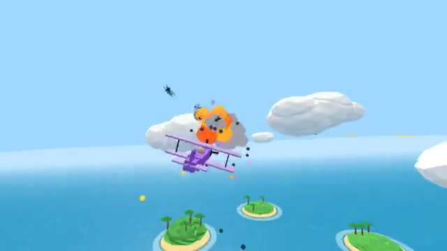

# Sky Dogfight

Biplanes, islands and a sky full of tracers. A multiplayer starter game from [Multiplayer Agent](https://multiplayeragent.com): 3D, versus, 2–8 players, with bots that fill empty seats.

## How it plays

Everyone for themselves over a ring of little islands. Your plane flies toward the mouse and levels itself, so just chase someone, get them in your sight and hold fire. Get shot down and you are back in the air in seconds. First to 10 kills wins.

**Controls:** Mouse to steer, hold the button or Space to fire, Shift to boost (WASD works too). On a phone: drag to steer, guns fire when a plane is in the sight.

## Make it yours in the Game Builder

Open the [Game Builder](https://multiplayeragent.com), choose **Start from a starter game** and pick Sky Dogfight. It opens as version 1 in your studio, ready to play and publish. Then ask for changes, for example:

- Add balloons to pop for bonus points
- Make it a team battle, red planes against blue
- Add a storm that closes in on the islands

## Run it yourself

1. Get a free publishable key (`pk_…`) at [multiplayeragent.com](https://multiplayeragent.com).
2. In `index.html`, put it in place of `pk_REPLACE_ME` in the `MP_CONNECT` block.
3. Serve the folder (for example `npx serve`) and open it. The 3D engine loads as a module, which browsers block from a file on disk.

Without a key it still runs, offline against bots.

## How it is built

- One `index.html` plus three.js in `libs/`. The comment at the top of the script maps the code and explains the multiplayer. Flight, guns and bots are tuned in `CONFIG`; the islands and clouds come from a seeded random, so everyone sees the same sky.
- **Leaderboard:** The most kills anyone has scored in one match.
- **Host-run rounds:** One player's browser counts the kills, runs the clock and calls the winner; if it leaves, the next player takes over.
- **Bots:** Bot pilots chase, lead their shots and break off until enough people join.
- **Live sync:** Every plane, burst of fire and explosion shows up for everyone at once. Each hit is decided by the shooter's browser, so what you hit on your screen counts.
- `?attract` runs it offline with bots only and a chase camera. The preview video is recorded from it.

## License

MIT. three.js in `libs/` is MIT too (Copyright 2010-2024 three.js authors).
